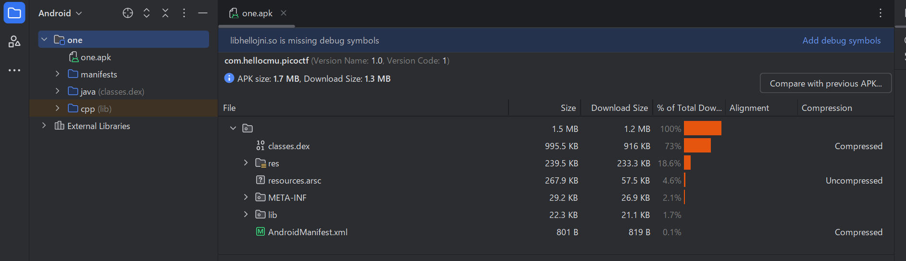
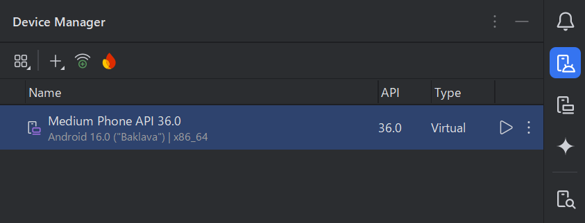
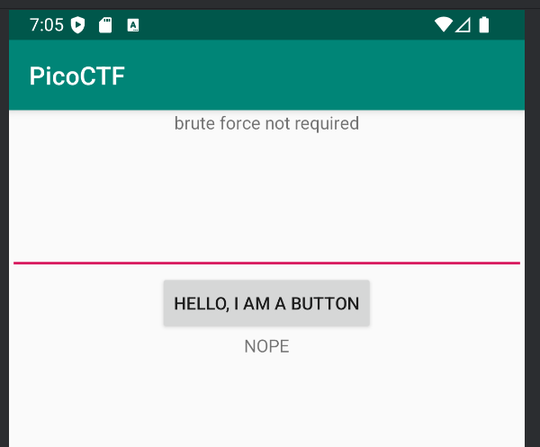
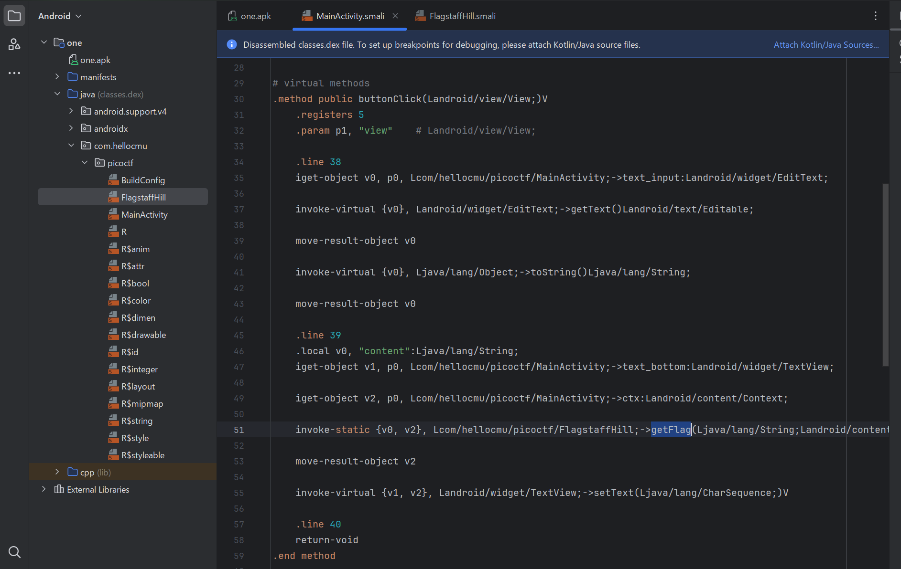
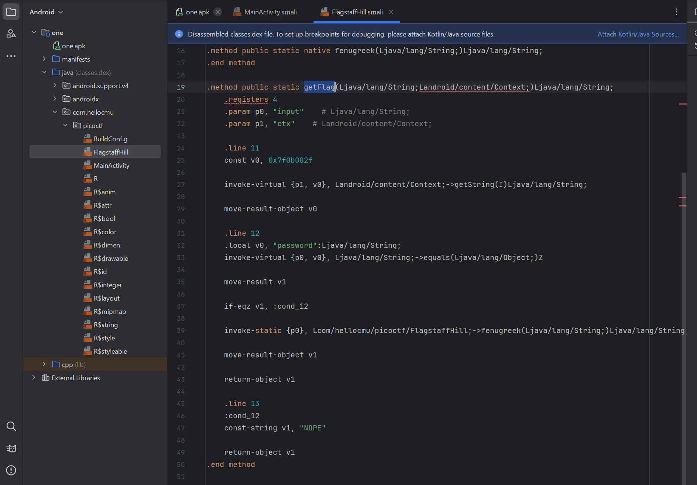
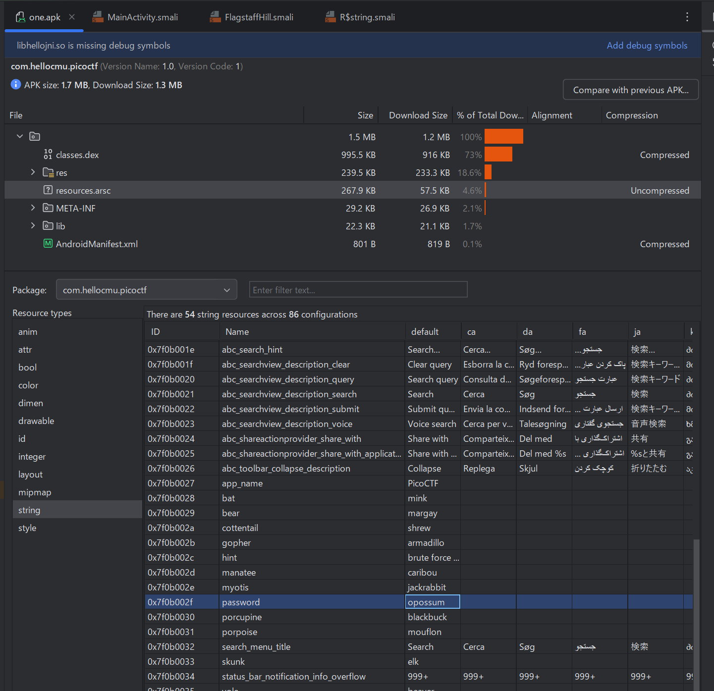
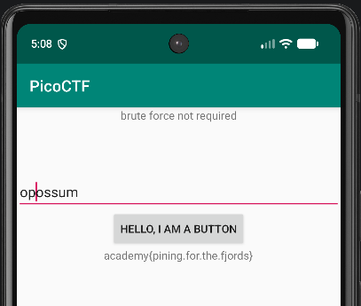

# droids1

<br>

URL: https://learn.cylabacademy.org/library/14

<br>

```
Reverse Engineering
Hard
by Jason
picoCTF 2019

Find the pass, get the flag. Check out this file.
```

<br>

## フラグ取得の過程  

「file」のリンクをクリックすると、ファイル名が「one.apk」のファイルをダウンどーどすることができる。

fileコマンドで確認すると、Androidのパッケージであることが分かる。

```
$ file one.apk
one.apk: Android package (APK), with AndroidManifest.xml, with APK Signing Block
```

Android Studioを使って、パッケージを確認する。

### Android Studio

Android Studioを起動し、「File」＞「Profile or Debug APK」と進み、ファイルダイアログから「one.apk」を選択して開く。



Android Studioの右側のペインから、Device Managerを選択し、基本となるデバイスを起動する。



デバイスが起動したら、メイン画面上に「one.apk」ファイルをドラッグしてアプリケーションをインストールする。

起動したアプリケーションは、シンプルなテキスト入力欄とボタンが表示される。正しいテキストを入力してボタンを押すと、フラグが表示される仕組みのようである。



これにより、コードを確認してみる。

画面左側から「one」＞「java」＞「com.hellocmu」＞「picoctf」＞「MainActivity」と辿ることで、メインの処理となるコードが表示される。

buttonClick()に、getFlag()が存在するのを確認できる。



そこで、getFlag()を検索する。

「one」＞「java」＞「com.hellocmu」＞「picoctf」＞「FlagstaffHill」にgetFlag()のコードが存在している。



passwordという記述があり、文字列として0x7f0b002fで定義されていることが分かる。

この0x7f0b002fの定義を確認するために、「one.apk」＞「resource.arsc」＞「string」を選択する。



表示されるリソースの構成から、0x7f0b002fを探す。passwordが「oppossum」であることが分かる。

エミュレーター上の仮想デバイスのテキスト欄に「oppossum」と入力し、ボタンを押すと、フラグが表示される。



<br>
<br>
<br>
<br>
<br>
<br>
<br>
<br>
<br>
<br>
<br>
<br>
<br>
<br>
<br>
<br>
<br>
<br>
<br>
<br>
<br>
<br>
<br>
<br>
<br>
<br>
<br>
<br>
<br>
<br>
<br>
<br>

## フラグ  

> academy{pining.for.the.fjords}
